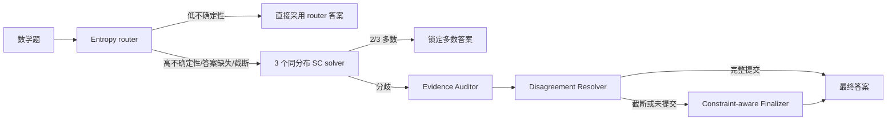

# Multi-Agent Mathematical Reasoning

本项目在单张 NVIDIA GPU 上，以本地 `Qwen3.5-4B` 为统一基座模型，比较 Direct、CoT、Self-Consistency 与 V1–V4.1 多智能体数学推理结构。最终交付版本为 **V4.1**；V1–V4 均作为结构演进与消融依据保留。

## 1. 最终结构：V4.1

V4.1 先用一个低成本 entropy router 判断是否需要协作。进入协作后，三个 solver 使用与 Self-Consistency 相同的 CoT 提示词、采样参数和独立随机种子：有 2/3 一致答案时立即锁定；只有没有形成多数时，才启动针对争议点的后续 agent。



后续 agent 不只是补齐 solver 被截断的末尾：

- `Evidence Auditor` 从三条独立轨迹中抽取题目目标、约束、已证事实和最早争议步骤，并给出必须复算的判别点；它不按票数选答案。
- `Disagreement Resolver` 只重算这个判别点，再回到原题核对答案类型、定义域、符号、计数重数或几何关系。
- `Constraint-aware Finalizer` 仅在 resolver 没有规范提交时使用；它检查已有推导是否满足审计器给出的提交条件，不重新展开完整求解。
- 若所有后续 agent 都无法可靠提交，只在三条 SC 轨迹中恰有一条“未截断且含规范最终答案”时才允许单例回退，否则输出未验证，避免凭空猜测。

每次模型调用最大输入和最大输出均为 4096 token。验证/争议解决 agent 可读取完整 4096-token 输入窗口，solver 轨迹通过 token-aware 摘要装入上下文，避免简单按字符只保留开头和结尾。

## 2. 版本演进

| 版本 | 主要结构 |
|---|---|
| V1 | Solver → Critic → Verifier → Judge，固定四次调用 |
| V2 | entropy router 决定单 agent 或条件协作 |
| V3 | 闭环验证、修订与困难题救援分支 |
| V4 | 三候选、条件 reviewer 与仲裁器 |
| V4.1 | 同分布 SC3 候选、多数锁定、仅对争议点进行证据审计与复算 |

## 3. 目录说明

```text
multi_agent_math/
├─ agents/          V1–V4.1 的角色 agent 与提示词
├─ baselines/       Direct、CoT、SC 及 V1–V4.1 工作流
│  └─ models/       本地 Qwen3.5 权重（约 9.3 GB）
├─ configs/         V2–V4.1 router 阈值配置
├─ core/            模型加载、生成配置、置信度与模型校验
├─ data/            dev_20、eval_200 和 V4.1 七道错题开发集
├─ results/         保留的开发集、正式集与配对分析结果
├─ scripts/         运行、分析、审计和环境检查入口
└─ utils/           答案抽取、归一化与数学等价判定
```

关键数据集：

- `data/dev_20.jsonl`：20 题开发集。
- `data/eval_200.jsonl`：固定 200 题正式集。

## 4. 实验环境

- Windows PowerShell。
- NVIDIA CUDA GPU；现有实验在单卡、4-bit NF4、BF16 计算配置下完成。
- 测试使用已经配置好的 Conda 环境。
- 默认模型目录：`baselines/models`。也可用环境变量 `MULTIAGENT_MODEL_PATH` 指向另一份完整的 Qwen3.5 权重。


## 5. 正式运行命令

所有运行脚本采用 JSONL 追加写入并支持断点续跑。同一 `problem_id + run_id + mode + method + experiment_version` 已存在时会跳过；重新实验应换输出文件或 `run-id`，不要覆盖保留结果。

### 5.1 V4.1 最终正式集

完整 200 题实测约 10–11 小时。

```powershell
& $pythonExe -m scripts.run_v4_1 `
  --mode adaptive `
  --input data/eval_200.jsonl `
  --output results/v4_1_eval_200_rerun.jsonl `
  --router-config configs/router_v4_1.json `
  --seed 42 `
  --run-id 1 `
  --strict-model
```

只运行指定题可重复传入 `--problem-id`；只跑前 N 题用 `--limit N`。

### 5.2 Direct 与 CoT

```powershell
& $pythonExe -m scripts.run_single_agent --method direct --input data/dev_20.jsonl --output results/direct_live.jsonl --limit 1 --strict-model
& $pythonExe -m scripts.run_single_agent --method cot    --input data/dev_20.jsonl --output results/cot_live.jsonl    --limit 1 --strict-model
```

### 5.3 Self-Consistency@5

```powershell
& $pythonExe -m scripts.run_self_consistency `
  --input data/dev_20.jsonl `
  --output results/sc_live.jsonl `
  --num-samples 5 `
  --seed 42 `
  --run-id 1 `
  --limit 1 `
  --strict-model
```

### 5.4 V1–V4

```powershell
# V1：固定 Solver → Critic → Verifier → Judge
& $pythonExe -m scripts.run_v1 --input data/dev_20.jsonl --output results/v1_live.jsonl --limit 1

# V2：自适应 router
& $pythonExe -m scripts.run_v2 --mode adaptive --input data/dev_20.jsonl --output results/v2_live.jsonl --router-config configs/router_v2.json --limit 1

# V3：闭环验证
& $pythonExe -m scripts.run_v3 --mode adaptive --input data/dev_20.jsonl --output results/v3_live.jsonl --router-config configs/router_v3.json --limit 1 --strict-model

# V4：候选 + reviewer + arbiter
& $pythonExe -m scripts.run_v4 --mode adaptive --input data/dev_20.jsonl --output results/v4_live.jsonl --router-config configs/router_v4.json --limit 1 --strict-model
```

## 6. 保留结果与正式结论

### 6.1 开发集结果

| 方法 | 正确数 / 20 | 结果文件 |
|---|---:|---|
| Direct | 17 / 20 | `results/direct_dev_20.jsonl` |
| CoT | 18 / 20 | `results/cot_dev_20.jsonl` |
| Self-Consistency@5 | 20 / 20 | `results/self_consistency_dev_20.jsonl` |
| V1 | 18 / 20 | `results/v1_dev_20.jsonl` |
| V2 | 16 / 20 | `results/v2_dev_20.jsonl` |
| V3 | 19 / 20 | `results/v3_dev_20.jsonl` |
| V4（run 2） | 20 / 20 | `results/v4_dev_20_run2.jsonl` |

开发集只用于结构迭代，不应用于声称正式泛化性能。

### 6.2 200 题正式集

| 方法 | 正确数 / 题数 | 准确率 | 模型调用 | 总 token | 说明 |
|---|---:|---:|---:|---:|---|
| Direct | 46 / 200 | 23.0% | 200 | 36,270 | 审计结果 |
| CoT | 174 / 200 | 87.0% | 200 | 263,794 | 审计结果 |
| Self-Consistency@5, seed 42 | 187 / 200 | 93.5% | 1,000 | 1,362,606 | 审计结果 |
| Self-Consistency@5, seed 43 | 189 / 200 | 94.5% | 1,000 | 1,366,850 | 完整运行 |
| Self-Consistency@5, seed 44 | 188 / 200 | 94.0% | 1,000 | 1,380,117 | 完整运行 |
| V2 | 172 / 200 | 86.0% | 620 | 1,277,038 | 完整运行 |
| V3 | 188 / 200 | 94.0% | 741 | 1,329,695 | 审计结果；另一次完整运行为 189/200 |
| V4 | 167 / 174 | — | 543 | 977,218 | 运行在 174 题处中断，不作为正式准确率 |
| **V4.1, seed 42** | **193 / 200** | **96.5%** | **558** | **947,433** | 最终主结果 |
| V4.1, seed 43 | 193 / 200 | 96.5% | 551 | 920,442 | 完整复验 |
| V4.1, seed 44 | 191 / 200 | 95.5% | 544 | 888,180 | 完整复验 |

V4.1 三次正式运行平均为 **192.33/200（96.17%）**。按相同 seed 42 比较，V4.1 比 SC@5 多答对 6 题（+3.0 个百分点），模型调用减少 442 次（-44.2%），总 token 减少约 30.5%。V4.1 seed 42 的 7 道错误全部为 Level 5。

seed 42 的分支构成：99 题由 router 直接回答；79 题形成 SC3 多数并锁定；11 题由 disagreement resolver 提交；5 题由 finalizer 提交；1 题使用唯一完整 SC 候选回退；5 题拒绝无依据提交。

正式结果文件：

- `results/direct_eval_200_audited.jsonl`
- `results/cot_eval_200_audited.jsonl`
- `results/self_consistency_eval_200_audited.jsonl`
- `results/v3_eval_200_audited.jsonl`
- `results/v4_1_eval_200.jsonl`
- `results/v4_1_eval_200_seed43.jsonl`
- `results/v4_1_eval_200_seed44.jsonl`

保留的无 `_audited` 旧文件用于实验追溯；论文/答辩引用时应优先采用表中明确标注的审计结果。`results/v4_eval_200.jsonl` 只有 174 行，不能把 167/174 外推为完整正式集成绩。